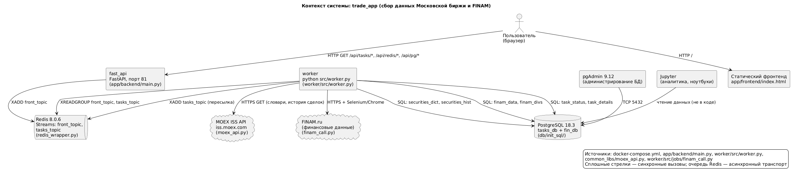
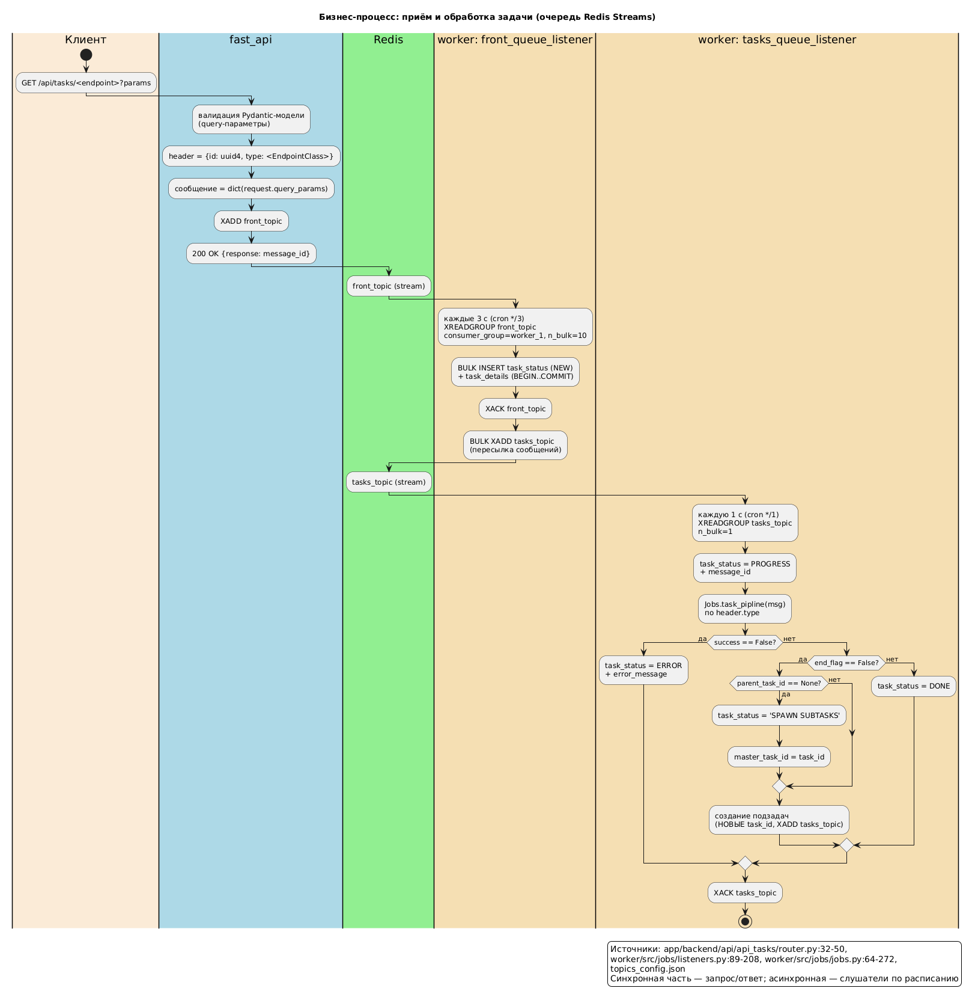
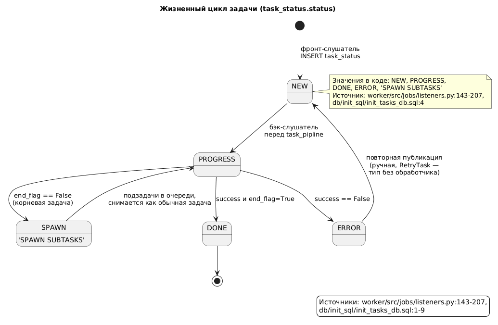
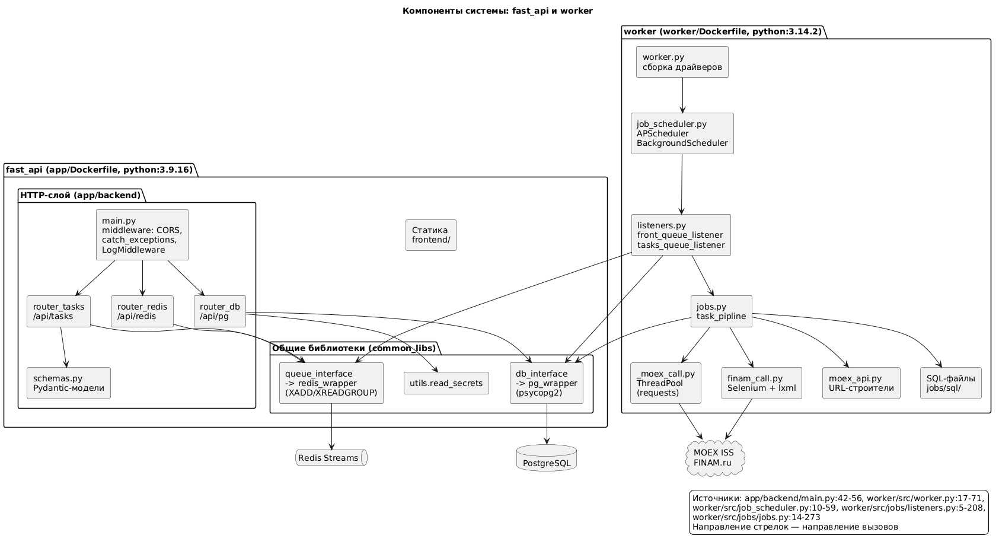
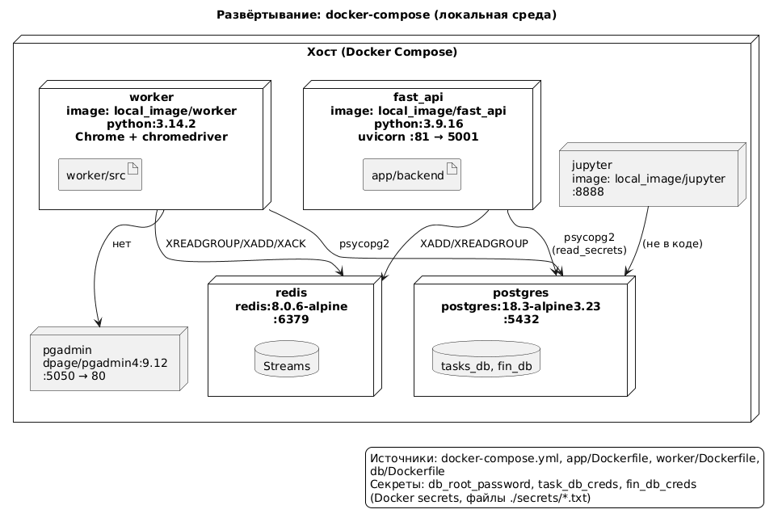
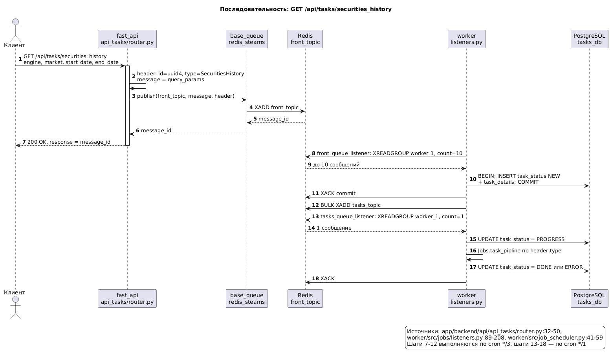
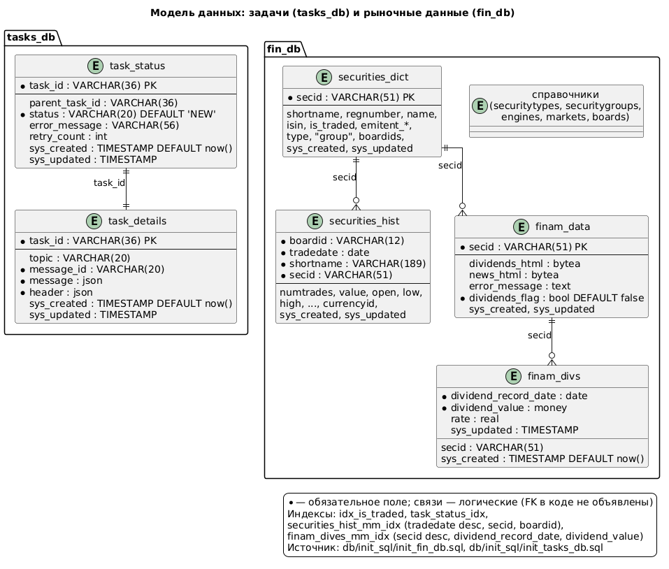
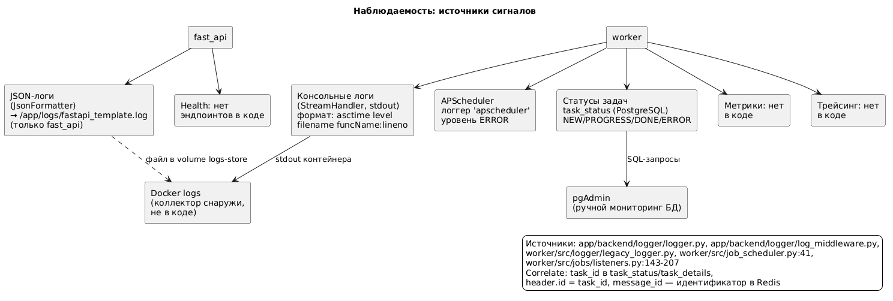

# trade_app — техническая документация

| Поле | Значение |
|---|---|
| Репозиторий | `/workspace/dock_code/trade_app` (локальный путь, удалённый origin не определён) |
| Ревизия | не определена: `git` недоступен в среде сборки (`git: command not found`); каталог `.git` присутствует |
| Версия | нет версии в манифестах: версии заданы только в lock-файлах (`app/requirements.in`, `worker/requirements.in`) |
| Дата документа | 2026-10-09 |
| Аудитория | разработчики и эксплуатация |
| Область | репозиторий целиком (два сервиса: `fast_api` и `worker`) |

---

## 1. Обзор и назначение

trade_app — локальная система сбора рыночных данных: загружает справочники ценных бумаг, историю сделок с Московской биржи (MOEX ISS API) и дивидендные данные с FINAM.ru, сохраняя их в PostgreSQL. Пользователь инициирует сбор через HTTP API (`fast_api`), задачи передаются через очереди Redis Streams и выполняются фоновым `worker` (`README.md:3`, `docker-compose.yml:2-48`).

**Ключевые возможности**

- HTTP API для постановки задач в очередь: произвольные GET-эндпоинты, автоматически регистрируемые из `app/backend/api/api_tasks/endpoint_settings.json:1-17` через `load_base_endpoints` — `app/backend/api/api_tasks/base_endpoints.py:4-11`
- Асинхронная обработка задач двумя слушателями по расписанию cron (APScheduler) — `worker/src/job_scheduler.py:10-59`
- Пайплайн-задачи, управляемые конфигурацией (`task_settings.json`): MOEX-словари, история торгов, подготовка FINAM, дивиденды — `worker/src/jobs/task_settings.json:1-190`, `worker/src/jobs/jobs.py:64-272`
- Параллельные HTTP-запросы к MOEX ISS с пагинацией (`limit`/`start`) — `common_libs/moex_api.py:19-75`, `worker/src/jobs/_moex_call.py:6-59`
- Скрейпинг страницы дивидендов FINAM через Selenium/Chrome в headless-режиме — `worker/src/jobs/finam_call.py:14-44`, `common_libs/selenium_wrapper.py:8-42`
- Учёт состояния задач в PostgreSQL (`task_status`, `task_details`) — `worker/src/jobs/listeners.py:39-208`, `db/init_sql/init_tasks_db.sql:1-20`
- Админ-API для Redis (создание consumer-групп, публикация, просмотр неподтверждённых сообщений) — `app/backend/api/api_redis/router.py:27-93`

**Границы**

- Делает: приём задач через API, транспортировку через Redis Streams, загрузку данных MOEX/FINAM, запись в PostgreSQL, отслеживание статусов задач.
- Не делает: аутентификация и авторизация (в коде нет ни одного middleware/зависимости для auth — `app/backend/main.py:42-56`); метрики, трейсинг, health-эндпоинты (не найдены в коде); retry с откатом (столбец `retry_count` существует, но нигде не заполняется — `db/init_sql/init_tasks_db.sql:6`); пользовательский интерфейс реальных операций (статический фронтенд — заготовка, см. «Открытые вопросы»).

**Стек**

| Компонент | Технология | Версия | Источник |
|---|---|---|---|
| Язык (fast_api) | Python | 3.9.16 | `app/Dockerfile:1` |
| Язык (worker) | Python | 3.14.2 | `worker/Dockerfile:2` |
| Веб-фреймворк | FastAPI / uvicorn | 0.128.8 / 0.39.0 | `app/requirements.in:25,75` |
| Валидация | Pydantic | 2.12.5 | `app/requirements.in:43` |
| Клиент Redis | redis-py | 7.0.1 (app) / 6.2.0 (worker) | `app/requirements.in:53`, `worker/requirements.in:50` |
| Клиент PostgreSQL | psycopg2 | 2.9.11 (binary, app) / 2.9.10 (worker) | `app/requirements.in:41`, `worker/requirements.in:42` |
| Планировщик | APScheduler | 3.11.0 | `worker/requirements.in:7` |
| HTTP-клиент | requests | 2.32.5 | `worker/requirements.in:52` |
| Браузер | Selenium + Chrome + chromedriver | 4.33.0 | `worker/requirements.in:54`, `worker/install-chrome.sh:15`, `worker/install-chromedriver.sh:15` |
| XML/HTML | lxml | 6.1.0 | `worker/requirements.in:29` |
| СУБД | PostgreSQL | 18.3-alpine3.23 | `db/Dockerfile:1` |
| Брокер | Redis | 8.0.6-alpine | `docker-compose.yml:53` |
| Админ БД | pgAdmin | 9.12 | `docker-compose.yml:86` |
| Лишняя зависимость | openpyxl | 3.1.5 — указан, но не импортирован в Python-коде | `app/requirements.in:33` |

**Запуск**

```sh
docker compose up        # все сервисы; порты из .env (docker-compose.yml:2-130)
# fast_api:  bash -c "/app/start.sh"  →  uvicorn backend.main:app --host 0.0.0.0 --port 81  (app/start.sh:8), маппинг 5001:81 (.env:1)
# worker:    bash -c "/worker/start.sh"  →  python src/worker.py  (worker/start.sh:8)
```

**Диаграмма:** 

Контекстная диаграмма показывает два приложения (`fast_api` и `worker`), два хранилища (PostgreSQL, Redis Streams) и два внешних источника данных (MOEX ISS, FINAM). Из неё следует асинхронная архитектура: API не обрабатывает данные, а только кладёт задачи в очередь; вся работа выполняется воркером. Исходник: [context.puml](diagrams/context.puml).

---

## 2. Бизнес-логика

**Доменные сущности**

| Сущность | Роль | Код |
|---|---|---|
| Задача (task) | единица работы: заголовок (`header`: `id`, `type`, опц. `parent_task_id`/`master_task_id`) + тело (`message` — параметры) | `app/backend/api/api_tasks/router.py:37-38`, `worker/src/jobs/listeners.py:188` |
| Тип задачи | имя класса Pydantic-схемы (`UploadSecuritiesDictionary`, `SecuritiesHistory`, `FinamSecPrepare` и др.); определяет пайплайн | `app/backend/api/api_tasks/endpoint_settings.json:1-17`, `worker/src/jobs/task_settings.json:1-190` |
| Подзадача (subtask) | порождённая задача с `parent_task_id`; у корневой задачи появляется `master_task_id` | `worker/src/jobs/listeners.py:159-184` |
| Consumer group | именованный потребитель Redis Stream (`worker_1`) | `topics_config.json:4,17` |
| Пайплайн-шаг | декларативное действие: `moex_method`, `add_parameter`, `change_query_param`, `execute_moex_method`, `sql` | `worker/src/jobs/jobs.py:82-181` |

**Основные сценарии**

### 2.1 Постановка задачи через API

1. Триггер: `GET /api/tasks/<endpoint_name>?<params>` — эндпоинт регистрируется динамически из `endpoint_settings.json` — `app/backend/api/api_tasks/base_endpoints.py:10`
2. Шаги: формируется заголовок `{'id': str(uuid4()), 'type': <имя класса>}`, тело — `dict(request.query_params)` — `app/backend/api/api_tasks/router.py:37-38`; сообщение публикуется в тему `msg_topic` (из env, по умолчанию `front_topic`) — `app/backend/api/api_tasks/router.py:20-23,39`
3. Резултат: `200 {"response": <message_id Redis>}` — `app/backend/api/api_tasks/router.py:40`

### 2.2 Приём задачи (front_queue_listener)

1. Триггер: cron `second: */3` из `topics_config.json:19-25` — `worker/src/job_scheduler.py:27-35`
2. Шаги: `XREADGROUP worker_1 > COUNT 10` из `front_topic` — `worker/src/jobs/listeners.py:101-105`, `common_libs/redis_wrapper.py:79-92`; массовый `INSERT` в `task_status` (status=`NEW`) и `task_details` в одной транзакции — `worker/src/jobs/listeners.py:39-68`, `worker/src/jobs/sql/tasks/create_task.sql:1-19`; подтверждение `XACK` — `worker/src/jobs/listeners.py:70-77`; массовая пересылка сообщений в `tasks_topic` — `worker/src/jobs/listeners.py:79-87`
3. Результат: задача записана в БД и перемещена в рабочую очередь

### 2.3 Выполнение задачи (tasks_queue_listener)

1. Триггер: cron `second: */1` из `topics_config.json:5-13` — `worker/src/job_scheduler.py:27-35`
2. Шаги: `XREADGROUP worker_1 > COUNT 1` — `worker/src/jobs/listeners.py:101-105`; статус `PROGRESS` + `message_id` — `worker/src/jobs/listeners.py:186-189`; вызов `Jobs.task_pipline` по `header.type` — `worker/src/jobs/jobs.py:64-272`; обновление статуса — `worker/src/jobs/listeners.py:192-207`; `XACK` — `worker/src/jobs/listeners.py:208`
3. Результат: `DONE` (успех), `ERROR` (неудача) или порождение подзадач (`SPAWN SUBTASKS`)

### 2.4 Пагинированная загрузка MOEX (execute_type=iteration)

1. Триггер: шаг `execute_moex_method` с `execute_type: iteration` — `worker/src/jobs/task_settings.json:7`
2. Шаги: формируется `moex_n_concurrent` (env) запросов со сдвигом `start = start + moex_limit * i` — `worker/src/jobs/jobs.py:107-118`; параллельный вызов через `ThreadPool` из `multiprocessing.dummy` — `worker/src/jobs/_moex_call.py:17-22`; пустой ответ (`len(data)==0`) означает `end_flag=True` — `worker/src/jobs/_moex_call.py:52-53`
3. Результат: если `end_flag=False`, задача переиздаётся как подзадача со смещённым `start` — `worker/src/jobs/jobs.py:184-190`

### 2.5 Дивиденды FINAM (finam_div)

1. Триггер: `header.type == FinamSecDiv` — `worker/src/jobs/task_settings.json:187-189`
2. Шаги: Selenium загружает `https://www.finam.ru/quote/moex/{secid}/dividends/` — `worker/src/jobs/finam_call.py:9-16`; парсинг таблицы через lxml XPath — `worker/src/jobs/finam_call.py:24-44`; запись дивидендов и HTML-копии страницы в БД — `worker/src/jobs/jobs.py:245-266`, `worker/src/jobs/sql/fin_db/update_finam_divs.sql:1-20`, `worker/src/jobs/sql/fin_db/update_finam_data.sql:1-9`
3. Результат: `finam_divs` пополнен, `finam_data.dividends_flag` выставлен

**Правила и ограничения**

- Размер пакета чтения из очереди: `n_bulk` — 10 для `front_topic`, 1 для `tasks_topic` — `topics_config.json:5,17`
- Параллелизм запросов MOEX: `moex_n_concurrent` (env, пример 100); размер страницы MOEX: `moex_limit` (env, пример 100) — `worker/src/jobs/jobs.py:39-42`, `.env:13-14`
- Максимум одновременных запусков слушателя: `max_instances: 1` для обеих тем — `topics_config.json:13,27`
- Ожидание загрузки страницы Selenium: 30 с — `common_libs/selenium_wrapper.py:37-42`
- Невалидный `header.type` → задача завершается с `ERROR` и сообщением «No task settings found for …» — `worker/src/jobs/jobs.py:66-72`

**Жизненный цикл задачи**

| Статус | Значение | Разрешённые переходы |
|---|---|---|
| `NEW` | создана при приёме из `front_topic` | → `PROGRESS` |
| `PROGRESS` | взята бэк-слушателем | → `DONE`, `ERROR`, `SPAWN SUBTASKS` |
| `DONE` | `success=True`, `end_flag=True` | терминальный |
| `ERROR` | `success=False` | терминальный (в коде автоматического retry нет) |
| `SPAWN SUBTASKS` | корневая задача, `end_flag=False` | → `PROGRESS` (при следующей обработке), но в коде статус ставится только один раз, см. ограничение ниже |

**Ошибки и компенсации**

- Ошибка HTTP-запроса MOEX → `success=False` + `error_message=repr(e)`, весь шаг прерывается — `worker/src/jobs/_moex_call.py:57-58`
- Ошибка Selenium → `{'success': False, 'error_message': traceback}` — `common_libs/selenium_wrapper.py:31-32`; страница «404» → `error_message='404 code page_title: …'` — `worker/src/jobs/finam_call.py:32-33`
- Ошибка задачи → статус `ERROR` + текст ошибки в `task_status.error_message` — `worker/src/jobs/listeners.py:192-193`
- Транзакция: `create_task.sql` оборачивает два INSERT в `BEGIN…COMMIT` — `worker/src/jobs/sql/tasks/create_task.sql:1,19`. Компенсаций (откат при сбое записи) нет: сообщение уже `XACK`-нуто после обработки — `worker/src/jobs/listeners.py:208`

**Синхронно / асинхронно**

- В запросе: только валидация и публикация в Redis (синхронно, в обработчике FastAPI) — `app/backend/api/api_tasks/router.py:32-42`
- В очереди/воркере: вся обработка — два слушателя по cron-расписанию (1 с и 3 с), не по событию — `worker/src/job_scheduler.py:41-59`, `topics_config.json:5-27`

**Диаграммы:**  

Процессная диаграмма с дорожками показывает путь сообщения от API через `front_topic` в `tasks_topic` и два слушателя. Диаграмма состояний — жизненный цикл `task_status.status`. Исходники: [business-flow.puml](diagrams/business-flow.puml), [task-lifecycle.puml](diagrams/task-lifecycle.puml).

---

## 3. Архитектура и контекст

**Тип архитектуры:** два отдельных процесса (веб-API и фоновый воркер), связанных через Redis Streams — фактически «очередь-ориентированная» связка, а не микросервисы: оба сервиса сборки из одного репозитория, но разных образов (`app/Dockerfile:1`, `worker/Dockerfile:2`), и между ними нет прямых вызовов, только очередь и общая БД. Внутри `fast_api` — трёхслойная структура: роутеры → общие библиотеки (динамически загружаемые драйверы) → внешние системы.

**Слои и модули**

| Модуль | Назначение | Кому разрешено вызывать | Код |
|---|---|---|---|
| `app/backend/main.py` | сборка приложения, middleware, регистрация роутеров, статика | точка входа uvicorn | `app/backend/main.py:15-56` |
| `app/backend/api/api_tasks` | динамические эндпоинты постановки задач | клиенты через HTTP | `app/backend/api/api_tasks/router.py:29-50` |
| `app/backend/api/api_redis` | админ Redis (топики, publish, consume) | клиенты через HTTP | `app/backend/api/api_redis/router.py:18-93` |
| `app/backend/api/api_db` | чтение списка таблиц и truncate | клиенты через HTTP | `app/backend/api/api_db/router.py:26-48` |
| `common_libs` | обёртки Redis/PostgreSQL, MOEX API, Selenium, чтение секретов | импортируется через `sys.path.append` обоими сервисами | `common_libs/*.py` |
| `worker/src/job_scheduler.py` | планировщик слушателей | `worker.py` | `worker/src/job_scheduler.py:10-59` |
| `worker/src/jobs/listeners.py` | чтение очередей, транзакции со статусами, пересылка | планировщик | `worker/src/jobs/listeners.py:5-208` |
| `worker/src/jobs/jobs.py` | исполнитель пайплайнов по типу задачи | слушатели | `worker/src/jobs/jobs.py:14-273` |

**Внешние системы**

| Система | Протокол | Что передаётся | Поведение при недоступности | Код |
|---|---|---|---|---|
| MOEX ISS | HTTPS GET | запросы словарей/истории, ответ JSON | `success=False`, задача → `ERROR` | `common_libs/moex_api.py:19-75`, `worker/src/jobs/_moex_call.py:57-58` |
| FINAM.ru | HTTPS + Selenium/Chrome | URL дивидендов, HTML страницы | `success=False` + traceback, задача → `ERROR` | `worker/src/jobs/finam_call.py:14-16`, `common_libs/selenium_wrapper.py:25-35` |
| Redis | TCP 6379 (redis-py) | Streams `front_topic`, `tasks_topic` | исключение на publish/consume (обработки нет) | `common_libs/redis_wrapper.py:5-105` |
| PostgreSQL | TCP 5432 (psycopg2) | SQL к `tasks_db` и `fin_db` | исключение (обработки нет); новое соединение на каждую операцию | `common_libs/pg_wrapper.py:11-16` |

**Поток запроса:** браузер/HTTP-клиент → `CORSMiddleware` → `catch_exceptions_middleware` → `LogMiddleware` (`app/backend/main.py:42-50`) → роутер (`/api/tasks|redis|pg`) → `base_queue`/`db_class` (`common_libs/queue_interface.py:11-20`, `common_libs/db_interface.py:10-21`) → Redis/PostgreSQL → `JSONResponse`

**Асинхронные связи**

| Событие | Транспорт | Публикует | Потребляет | Код |
|---|---|---|---|---|
| новая задача | Redis Stream `front_topic` | fast_api | worker (front_queue_listener) | `app/backend/api/api_tasks/router.py:39`, `worker/src/jobs/listeners.py:125-133` |
| задача на выполнение | Redis Stream `tasks_topic` | worker (front_queue_listener) | worker (tasks_queue_listener) | `worker/src/jobs/listeners.py:79-87,135-141` |
| подзадача | Redis Stream `tasks_topic` | worker (tasks_queue_listener) | worker (tasks_queue_listener) | `worker/src/jobs/listeners.py:159-184` |

**Сквозные механизмы**

- Аутентификация/авторизация: отсутствует; CORS открыт для всех origins (`allow_origins=['*']`) — `app/backend/main.py:42-48`
- Обработка ошибок: глобальный middleware ловит исключения и возвращает `{'message': 'Error:…' + стек-трейс (без кадров starlette/fastapi)}` с нестандартным заголовком `{'status': 'error'}` — `app/backend/main.py:18-39`
- Кэширование: нет (не найдено в коде)

**Ограничения и техдолг**

- `app/backend/api/api_db/router.py:28` — `pg_conn = str(getenv('pg_url'))` — неиспользуемая переменная (`pg_url` нигде не задан)
- `app/backend/api/api_tasks/message_broker.py:8-18` — класс `MessageBroker` не используется (роутер использует `queue_interface.base_queue` напрямую)
- `worker/src/logger/logger.py:29` — путь `/app/logs/fastapi_template.log` скопирован из fast_api в воркер (у воркера WORKDIR `/worker`), и сам `JsonFormatter` воркером не импортируется (`worker.py:2` использует `legacy_logger`)
- `worker/src/jobs/listeners.py:143-157` — статус и `error_message` подставляются строковой интерполяцией в SQL (риск инъекции через текст исключения)
- `worker/src/jobs/sql/tasks/update_task_status.sql:4` — `error_message` вставляется как литерал, без параметризации
- `worker/src/jobs/jobs.py:75` — сравнение `message['message'].get('truncate','false') == 'true'`: `truncate` из схемы — `bool`, а не строка, поэтому флаг truncate никогда не сработает для задач MOEX

**Диаграммы:**  

Компонентная диаграмма показывает слои fast_api и worker и направление вызовов (динамическая загрузка драйверов из `common_libs`). Диаграмма развёртывания — шесть контейнеров docker-compose и их связи. Исходники: [components.puml](diagrams/components.puml), [deployment.puml](diagrams/deployment.puml).

---

## 4. API и контракты

**Базовый URL и версионирование:** `http://<хост>:5001` (маппинг `5001:81`, `.env:1`, `docker-compose.yml:28`); версионирования нет, все пути без префикса версии.

| Метод | Путь | Назначение | Auth / роль | Обработчик |
|---|---|---|---|---|
| GET | `/api/tasks/<endpoint_name>` | постановка задачи в `front_topic`; `<endpoint_name>` — ключ из `endpoint_settings.json` | нет | `app/backend/api/api_tasks/router.py:32-42` (через `base_endpoints.py:10`) |
| GET | `/api/tasks/items/` | заглушка: возвращает `order_by` | нет | `app/backend/api/api_tasks/router.py:45-47` |
| GET | `/api/redis/info` | информация о Redis-сервере | нет | `app/backend/api/api_redis/router.py:27-30` |
| DELETE | `/api/redis/all` | `FLUSHALL` (очистка всех ключей) | нет | `app/backend/api/api_redis/router.py:33-36` |
| POST | `/api/redis/publish` | публикация сообщения в произвольный топик | нет | `app/backend/api/api_redis/router.py:39-43` |
| GET | `/api/redis/consume/{topic}/{consumer_group}` | чтение 1 сообщения + `XACK` | нет | `app/backend/api/api_redis/router.py:46-52` |
| POST | `/api/redis/create/topic` | создание consumer-группы для топика | нет | `app/backend/api/api_redis/router.py:55-61` |
| POST | `/api/redis/create/topic/all` | создание групп для всех топиков из `topics_config.json` (опц. `delete_all=true` → `FLUSHALL`) | нет | `app/backend/api/api_redis/router.py:64-71` |
| GET | `/api/redis/topic/info/all` | информация о группах всех топиков | нет | `app/backend/api/api_redis/router.py:74-79` |
| GET | `/api/redis/topic/get_uncommited_messages/all` | неподтверждённые сообщения (по умолчанию 10) | нет | `app/backend/api/api_redis/router.py:82-87` |
| GET | `/api/redis/topic/info/{topic_id}` | информация о группах одного топика | нет | `app/backend/api/api_redis/router.py:90-93` |
| GET | `/api/pg/user_tables` | список пользовательских таблиц PostgreSQL | нет | `app/backend/api/api_db/router.py:38-42` |
| GET | `/api/pg/truncate/{table_name}` | `TRUNCATE <table_name>` | нет | `app/backend/api/api_db/router.py:45-48` |
| GET | `/` | статический фронтенд (`frontend/index.html`) | нет | `app/backend/main.py:56` |

Зарегистрированные задачи (динамические GET-эндпоинты `/api/tasks/...`): `upload_securities_dictionary`, `task_retry`, `upload_moex_dictionaries`, `securities_history`, `finam_sec_prepare` — `app/backend/api/api_tasks/endpoint_settings.json:1-17`.

**Модели**

### `GET /api/tasks/securities_history`

Запрос (query-параметры, схема `SecuritiesHistory` — `app/backend/api/api_tasks/schemas.py:36-40`):

```json
{
  "engine": "str, default 'stock'",
  "market": "str, default 'shares'",
  "start_date": "date, default 01.01.<start_trade_year>",
  "end_date": "date, default сегодня"
}
```

Ответ `200`:

```json
{ "response": "<message_id Redis Stream>" }
```

Ошибки:

| Код | Условие | Тело |
|---|---|---|
| 422 | невалидный query-параметр | стандартный FastAPI ValidationError |
| 500 | исключение в обработчике | `{"message": "Error:<текст>Traceback: File: …"}` с заголовком `status: error` — `app/backend/main.py:36-39` |

### `POST /api/redis/publish`

Запрос (схема `PublishMessage` — `app/backend/api/api_redis/schemas.py:13-16`):

```json
{ "topic": "str", "message": "dict", "header": "dict" }
```

Ответ `200`: `{"<message_id>": "..."}` (результат `XADD`).

### `POST /api/redis/create/topic`

Запрос (схема `TopicParam` — `app/backend/api/api_redis/schemas.py:8-10`):

```json
{ "topic": "str", "consumer_group": "str" }
```

Ответ `200`: `{"status": true, "error": null}` либо `{"status": false, "error": "<текст>"}` — `common_libs/redis_wrapper.py:28-35`.

**Аутентификация:** отсутствует полностью — ни middleware, ни зависимости, ни роли не найдены в коде (`app/backend/main.py:15-56`).

**Пагинация и фильтры:** в API нет; пагинация реализована только внутри загрузки MOEX (`limit`/`start`, `worker/src/jobs/jobs.py:107-118`).

**События**

| Событие | Payload | Гарантии | Идемпотентность |
|---|---|---|---|
| запись в `front_topic` | `{message: <JSON params>, header: <JSON {id, type}>}` | at-least-once (XACK после обработки; при сбое воркера сообщение останется неподтверждённым) | `task_status` UPSERT по `task_id` (ON CONFLICT DO UPDATE) — `worker/src/jobs/sql/tasks/create_task.sql:4-8`; но повторная публикация той же задачи создаст новую запись |
| запись в `tasks_topic` | аналогично | at-least-once | аналогично |

**Ограничения:** лимиты запроса/тела не заданы; таймауты HTTP к MOEX не заданы (`requests.Session.get` без `timeout` — `worker/src/jobs/_moex_call.py:50`); rate limit нет.

**Диаграмма:** 

Диаграмма последовательности для `GET /api/tasks/securities_history`: синхронная часть (шаги 1–6) и два цикла слушателей по cron (шаги 7–12 — каждые 3 с, 13–18 — каждую 1 с). Исходник: [api-sequence.puml](diagrams/api-sequence.puml).

---

## 5. Модель данных

**Хранилища:** PostgreSQL 18.3 (две базы: `tasks_db` — учёт задач, `fin_db` — рыночные данные; создаются при инициализации контейнера — `db/init.sh:1-29`), Redis 8.0.6 (только Streams как транспорт, данные не хранятся постоянно по замыслу).

| Таблица/коллекция | Назначение | Ключ | Модуль-владелец |
|---|---|---|---|
| `task_status` | статусы задач | `task_id` VARCHAR(36) PK | worker (`listeners.py`) |
| `task_details` | тела и заголовки задач, связь с Redis | `task_id` VARCHAR(36) PK | worker (`listeners.py`) |
| `securities_dict` | справочник ценных бумаг MOEX | `secid` VARCHAR(51) PK | worker (`jobs.py`) |
| `securitytypes` | типы ЦБ | `id` int PK | worker |
| `securitygroups` | группы ЦБ | `id` int PK | worker |
| `engines` | торговые системы | `id` int PK | worker |
| `markets` | рынки | PK (`engine`, `id`) | worker |
| `boards` | режимы торгов | PK (`engine`, `market`, `id`) | worker |
| `securities_hist` | история сделок по дням | PK не объявлен; UNIQUE (`tradedate desc`, `secid`, `boardid`) | worker |
| `finam_data` | HTML-копии страниц дивидендов и флаги | `secid` VARCHAR(51) PK | worker |
| `finam_divs` | дивиденды | UNIQUE (`secid desc`, `dividend_record_date`, `dividend_value`) | worker |
| `nonqual_shares` | VIEW: торгуемые акции TQBR | — | `db/init_sql/init_fin_db.sql:107-112` |

**Поля значимых сущностей**

| Сущность | Поле | Тип | Обяз. | По умолчанию | Ограничение |
|---|---|---|---|---|---|
| `task_status` | `task_id` | VARCHAR(36) | да | — | PK |
| `task_status` | `parent_task_id` | VARCHAR(36) | нет | NULL | индекс `task_status_idx` |
| `task_status` | `status` | VARCHAR(20) | да | 'NEW' | — |
| `task_status` | `error_message` | VARCHAR(56) | нет | NULL | — |
| `task_status` | `retry_count` | int | нет | NULL | не заполняется в коде |
| `task_details` | `message_id` | VARCHAR(20) | да | — | идентификатор сообщения Redis |
| `task_details` | `message` / `header` | json | да | — | — |
| `securities_dict` | `secid` | VARCHAR(51) | да | — | PK; индекс `idx_is_traded (is_traded)` |
| `finam_data` | `dividends_html` | bytea | нет | NULL | base64-кодированный HTML в коде (`finam_call.py:21`) |
| `finam_data` | `dividends_flag` | bool | да | false | — |
| `finam_divs` | `dividend_value` | money | да | — | — |
| `finam_divs` | `rate` | real | нет | NULL | — |

Полный список полей: `db/init_sql/init_fin_db.sql:1-135`, `db/init_sql/init_tasks_db.sql:1-20`.

**Связи:** `task_status` 1:1 `task_details` по `task_id` (без FK — связь логическая). `securities_dict` 1:N `securities_hist` и `finam_data` по `secid`; `finam_data` 1:N `finam_divs` по `secid`. Внешние ключи в DDL не объявлены нигде — целостность обеспечивается только логически.

**Индексы и уникальность**

| Индекс | Поля | Обслуживает запрос |
|---|---|---|
| `task_status_idx` | `parent_task_id` | поиск подзадач задачи (`db/init_sql/init_tasks_db.sql:10`) |
| `idx_is_traded` | `securities_dict(is_traded)` | фильтр торгуемых ЦБ (`db/init_sql/init_fin_db.sql:20-21`) |
| `securities_hist_mm_idx` (UNIQUE) | `tradedate desc, secid, boardid` | идемпотентная вставка истории (`db/init_sql/init_fin_db.sql:91`) |
| `finam_dives_mm_idx` (UNIQUE) | `secid desc, dividend_record_date, dividend_value` | идемпотентная вставка дивидендов (`db/init_sql/init_fin_db.sql:134`) |

**Целостность и транзакции:** FK и каскады не используются. Транзакция только в `create_task.sql` (`BEGIN; INSERT task_status; INSERT task_details; COMMIT` — `worker/src/jobs/sql/tasks/create_task.sql:1-19`). Каждая операция psycopg2 открывает новое соединение (`common_libs/pg_wrapper.py:11-16`). `ON CONFLICT DO UPDATE` используется для UPSERT в `create_task.sql`, `finam_sec_list.sql`, `update_finam_divs.sql` и `insert_many` (`common_libs/pg_wrapper.py:25-35`).

**Миграции:** миграционного инструмента нет. Схема создаётся однократно при первом старте контейнера postgres через `docker-entrypoint-initdb.d` — `db/Dockerfile:1-7`, `db/init.sh:1-29`. Обратности нет; опасная операция — `drop_default_bd.sql` удаляет базы `postgres` и `user_pg` (`db/init_sql/drop_default_bd.sql:1-3`, вызов `db/init.sh:29`).

**Кэш:** нет (не найдено в коде). Redis используется только как транспорт сообщений.

**Персональные данные:** в БД хранятся рыночные данные и идентификаторы задач; персональных данных пользователей в моделях нет. Секреты (учётные данные БД) читаются из Docker-секретов и используются только для подключения — `common_libs/utils.py:1-9`, `worker/src/worker.py:17-36`.

**Диаграмма:** 

ER-диаграмма двух баз (`tasks_db` и `fin_db`) с ключевыми полями, индексами и логическими связями. Исходник: [data-model.puml](diagrams/data-model.puml).

---

## 6. Конфигурация

| Параметр | Назначение | Тип | Дефолт | Обяз. | Источник | Что при неверном значении |
|---|---|---|---|---|---|---|
| `app_ports` | маппинг порта fast_api | str | — | да | `.env:1`, `docker-compose.yml:28` | контейнер не поднимется |
| `timezone` | TZ контейнеров | str | — | да | `.env:2`, `docker-compose.yml:9` | предупреждение compose |
| `app_code_source`, `worker_code_source`, `common_libs` | bind-монтирование кода | path | — | да | `.env:4,10,13`, `docker-compose.yml:135-161` | код не будет виден в контейнере |
| `logs_dir` | каталог логов fast_api | path | — | да | `.env:5`, `docker-compose.yml:143-148` | лог-файл не запишется |
| `log_level` | уровень логирования fast_api | str | INFO (в коде) | нет | `.env:6`, `app/backend/logger/logger.py:32` | `getenv` вернёт None → INFO |
| `app_name` | имя приложения | str | — | да | `.env:7`, `docker-compose.yml:10` | — |
| `msg_topic` | тема публикации задач | str | — | да | `.env:8`, `docker-compose.yml:14`, `app/backend/api/api_tasks/router.py:20` | `None` → ошибка publish |
| `start_trade_year` | год начала истории по умолчанию | int | — | да | `.env:9`, `docker-compose.yml:16`, `app/backend/api/api_tasks/schemas.py:39` | `int(None)` → ошибка при импорте схемы |
| `redis_url` | URL Redis | str | — | да | `.env:16`, `docker-compose.yml:11` | нет соединения с брокером |
| `db_host` | хост PostgreSQL | str | — | да | `.env:26`, `docker-compose.yml:15` | нет соединения с БД |
| `db_name`, `db_root_user`, `db_pswd` | инициализация postgres | str | — | да | `.env:20-23`, `docker-compose.yml:67-68` | контейнер postgres не поднимется |
| `db_ports`, `db_data`, `postgresql_conf` | порт, данные, конфиг postgres | — | — | да | `.env:24-27`, `docker-compose.yml:77-82` | — |
| `moex_limit`, `moex_n_concurrent` | страница и параллелизм MOEX | int | — | да (worker) | `.env:13-14`, `docker-compose.yml:39-40`, `worker/src/jobs/jobs.py:39-42` | `int(None)` → ошибка в `Jobs.__init__` |
| `pgadmin_email`, `pgadmin_pswd`, `pgadmin_server_mode`, `pgadmin_ports` | pgAdmin | — | — | да | `.env:32-36`, `docker-compose.yml:84-96` | pgAdmin не поднимется |
| `juputer_ports`, `notebook_folder`, `data_folder`, `user` | Jupyter | — | — | да | `.env:38-41`, `docker-compose.yml:103-130` | Jupyter не поднимется |

**Профили и среды:** единая локальная среда через docker-compose; различия dev/stage/prod в коде не описаны. `.devcontainer/docker-compose.yml:1-13` задаёт отдельную dev-среду (Python 3.14, `sleep infinity`).

**Секреты:** три Docker-секрета — `db_root_password` (`./secrets/db_root_password.txt`), `task_db_creds`, `fin_db_creds` (`./secrets/*.txt`) — `docker-compose.yml:191-197`. Примеры (без реальных значений) — `secrets_example/`. Чтение: `read_secrets` парсит файл `KEY=VALUE` построчно — `common_libs/utils.py:1-9`. **Каталог `./secrets/` в репозитории отсутствует**, пример `fin_db_creds.txt` тоже отсутствует (только `db_root_password.txt` и `task_db_creds.txt`) — перед запуском нужно создать. Значения в документ не выводятся.

**Флаги поведения**

- `truncate` (в теле задачи, bool, default `False`/`True` в зависимости от схемы) → очистка таблицы перед вставкой — `worker/src/jobs/jobs.py:173-174`; **не работает для MOEX-задач из-за сравнения bool со строкой** (`worker/src/jobs/jobs.py:75`)
- `delete_all` (query-параметр `/api/redis/create/topic/all`) → `FLUSHALL` перед созданием групп — `app/backend/api/api_redis/router.py:65-67`

**Производительность**

- fast_api: однопроцессный uvicorn (без `--workers`), пул соединений БД нет (новое соединение на операцию) — `app/start.sh:8`, `common_libs/pg_wrapper.py:11-16`
- worker: `ThreadPool(moex_n_concurrent)` для MOEX-запросов — `worker/src/jobs/_moex_call.py:17`; слушатели с `max_instances: 1` — `topics_config.json:13,27`
- PostgreSQL: `max_connections = 100`, `shared_buffers = 128MB`, `max_wal_size = 1GB` — `db/postgresql.conf:65,129,257`
- pgAdmin: лимит 0.5 CPU / 1G RAM — `docker-compose.yml:97-101`
- Таймауты: HTTP-запросы MOEX без `timeout` (может зависнуть навсегда) — `worker/src/jobs/_moex_call.py:50`; Selenium — 30 с — `common_libs/selenium_wrapper.py:37-42`

**Порядок запуска:** `docker compose up` → postgres (init.sh создаёт `tasks_db` и `fin_db` из секретов) → redis → fast_api (создаёт consumer-группы вручную через `POST /api/redis/create/topic/all` — README требует «use api to create queue topics», `README.md:2`) → worker. Миграции не нужны (схема создаётся при инициализации).

**Диаграмма:** развёртывание (раздел 3) — среды не различаются, конфигурация едина.

---

## 7. Мониторинг и логи

**Логи**

- Формат fast_api: JSON с полями `created`, `levelname`, `message` + произвольные `custom_fields`; на уровне ERROR добавляется `err` (форматированный exception) — `app/backend/logger/logger.py:8-24`
- Формат worker: текст `[%(asctime)s %(levelname)s %(filename) s %(funcName) s:%(lineno) s] %(message)s` — `worker/src/logger/legacy_logger.py:6,14`
- Уровни: fast_api — из env `log_level` (default INFO; в `.env` — DEBUG) — `app/backend/logger/logger.py:32`; worker — консольный `basicConfig` без явного уровня + отдельный логгер `apscheduler` на уровне ERROR — `worker/src/logger/legacy_logger.py:5-8`, `worker/src/worker.py:41`
- Назначение: fast_api пишет в файл `/app/logs/fastapi_template.log` (volume `logs-store`) — `app/backend/logger/logger.py:29`, `docker-compose.yml:22`; worker — в stdout контейнера — `worker/src/logger/legacy_logger.py:17-19`. `uvicorn.access` отключён — `app/backend/logger/logger.py:35`

**Ключевые сообщения**

| Ситуация | Что искать в логах | Код |
|---|---|---|
| входящий запрос | `Incoming request` с полями `request` (method, url) и `response` (status_code) | `app/backend/logger/log_middleware.py:8-16` |
| вставка задачи | `inserted in db res=… messages:topic=… message_ids=… header_ids=…` | `worker/src/jobs/listeners.py:66-68` |
| подтверждение | `commited message_ids=…` | `worker/src/jobs/listeners.py:77` |
| пересылка в back-очередь | `tasks moved to back_queue queue,res=…` | `worker/src/jobs/listeners.py:87` |
| выполнение задачи | тело сообщения, затем `////////////////////<result>` | `worker/src/jobs/listeners.py:187,191` |
| создание подзадачи | `published <res>` | `worker/src/jobs/listeners.py:184` |
| обработка FINAM | `process <secid>` | `worker/src/jobs/jobs.py:249` |
| ошибка APScheduler | события `EVENT_JOB_ERROR` (закомментированы, не обрабатываются) | `worker/src/job_scheduler.py:7,44` |

**Корреляция:** `task_id` (=`header.id`) связывает сообщение Redis, строки `task_status`/`task_details` и логи воркера; `message_id` — идентификатор сообщения в Redis. request_id/trace_id нет (не найден в коде).

**Метрики:** не найдены в коде (нет prometheus_client, statsd, OTel).

**Проверки состояния:** health/liveness/readiness эндпоинтов нет; в docker-compose `healthcheck` не задан ни для одного сервиса.

**Трейсинг:** не найден в коде.

**Алерты:** не найдены в коде (нет alert-файлов, Alertmanager, Grafana).

**Аудит и персональные данные в логах:** логи воркера пишут полные тела сообщений (`logger.info(f'~~~~~~~~~~~~~~~~~~~~{msg}')` — `worker/src/jobs/listeners.py:187`) и полные exception-трейсы; маскирования нет. Персональных данных в задачах нет (только рыночные параметры), но текст ошибок может содержать произвольные строки.

**Диагностика: симптом → куда смотреть**

| Симптом | Метрика/лог | Вероятная причина |
|---|---|---|
| задача застряла в `PROGRESS` | `task_status`, логи воркера | исключение в `task_pipline` без перехода в `ERROR`; или воркер не читает `tasks_topic` |
| сообщение не обрабатывается | `/api/redis/topic/get_uncommited_messages/all` | consumer-группа не создана (`POST /api/redis/create/topic/all`) или `XACK` не выполнен |
| `ERROR` у задачи | `task_status.error_message` | недоступен MOEX/FINAM, неверный `header.type`, ошибка парсинга FINAM |
| пустая история при неполных данных | `securities_hist` | `end_flag` логики пагинации; проверьте `next_start` и `moex_limit` |
| воркер молчит | stdout контейнера | APScheduler не запущен или cron-конфигурация в `topics_config.json` невалидна |

**Диаграмма:** 

Карта источников сигналов: JSON-логи fast_api (файл), консольные логи воркера (stdout), статусы задач в PostgreSQL как фактический источник состояния; health/метрики/трейсинг отсутствуют. Исходник: [observability.puml](diagrams/observability.puml).

---

## Открытые вопросы

| # | Вопрос | Почему открыт | К кому |
|---|---|---|---|
| 1 | Точка назначения `/api/upload`, на которую шлёт форму статический фронтенд (`app/frontend/static/js/index.js:1`) | в бэкенде нет такого маршрута; зависимость `openpyxl` (для Excel-файлов из формы) указана, но не импортирована в Python-коде — `app/requirements.in:33`. Фронтенд — недоделанная заготовка | владелец репозитория |
| 2 | Точные учётные данные и состав `./secrets/fin_db_creds.txt` | пример секрета отсутствует в `secrets_example/`, каталог `./secrets/` не создан; docker-compose его требует (`docker-compose.yml:196-197`) | владелец репозитория |
| 3 | Ревизия (git hash) и удалённый origin | `git` недоступен в среде сборки (`git: command not found`), `.git` присутствует | владелец репозитория |
| 4 | Действительный ли статус `SPAWN SUBTASKS` как отдельное состояние | он записывается в БД (`worker/src/jobs/listeners.py:200`), но при повторной обработке той же задачи код сразу переводит её в `PROGRESS`; перехода из `SPAWN SUBTASKS` в финальное состояние корневой задачи нет (обновление мастер-задачи в `listeners.py:204-205` вызывается с тем же статусом, что и у подзадачи) | владелец репозитория |
| 5 | Зачем в схемах `api_tasks/schemas.py` классы `MessageBody`/`MessageHeader` (поле `task_name`), если реальный заголовок формируется в `router.py:37` с полем `type` | рассогласование схемы и кода; схемы `MessageBody`/`MessageHeader` не используются в обработчиках | владелец репозитория |
| 6 | Используется ли `RetryTask` (эндпоинт `task_retry`) для повтора | тип задачи `RetryTask` в `task_settings.json:34-36` имеет `"type": "tasks"`, для которого в `Jobs.task_pipline` нет ветки — задача всегда завершится `ERROR` («No task settings["type"] found») | владелец репозитория |
| 7 | Планируется ли переход на параметризованные SQL-запросы | статус и текст ошибки подставляются интерполяцией (`worker/src/jobs/listeners.py:143-157`, `worker/src/jobs/sql/tasks/update_task_status.sql:4`) — риск инъекции | владелец репозитория |
| 8 | Корректность флага `truncate` для MOEX-задач | в коде bool сравнивается со строкой `'true'` (`worker/src/jobs/jobs.py:75`), поэтому truncate фактически никогда не включается для этих задач | владелец репозитория |

---

**Что установлено из кода:** состав сервисов (`fast_api`, `worker`), стек и версии, полный список API-эндпоинтов, механизм очередей Redis Streams (front/back topics, consumer group `worker_1`), жизненный цикл задачи (`NEW → PROGRESS → DONE/ERROR/SPAWN SUBTASKS`), конфигурацию пайплайнов MOEX/FINAM из `task_settings.json`, схему двух баз данных, конфигурацию из `.env`/docker-compose и Docker-секретов, устройство логирования.

**Что требует подтверждения владельцем:** открытые вопросы 1–8 выше (в первую очередь — недостающие секреты `fin_db_creds` и назначение фронтенда/`/api/upload`).

**Неполные разделы:** раздел «Мониторинг и логи» содержит факты о логах, но метрики, трейсинг, health-проверки и алерты в коде отсутствуют — зафиксировано явно, а не выдумано. Ревизия git недоступна из-за отсутствия `git` в среде.
